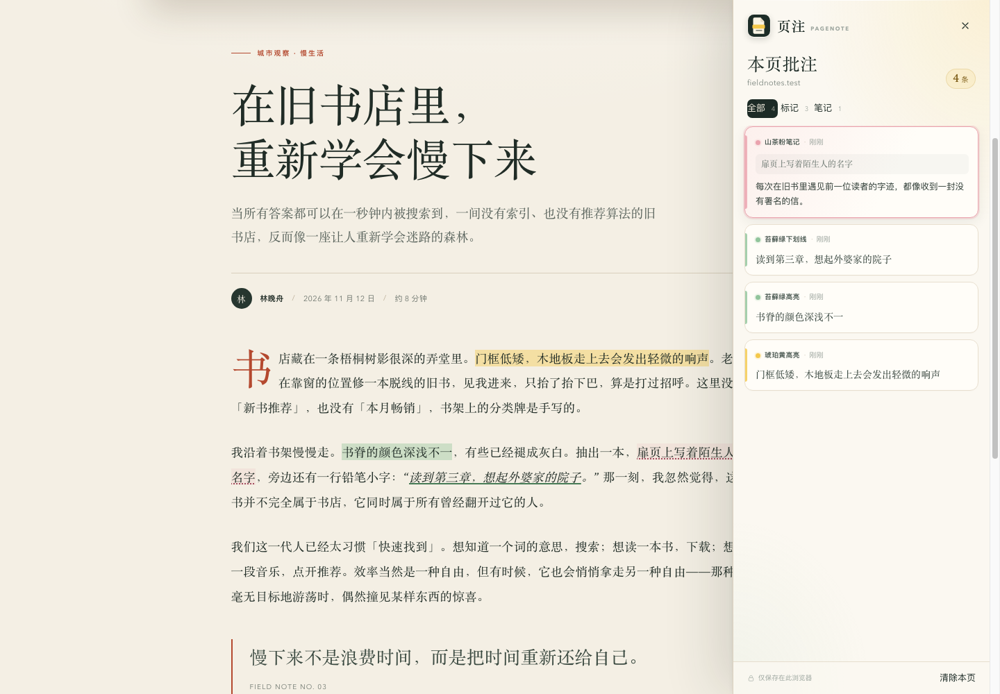
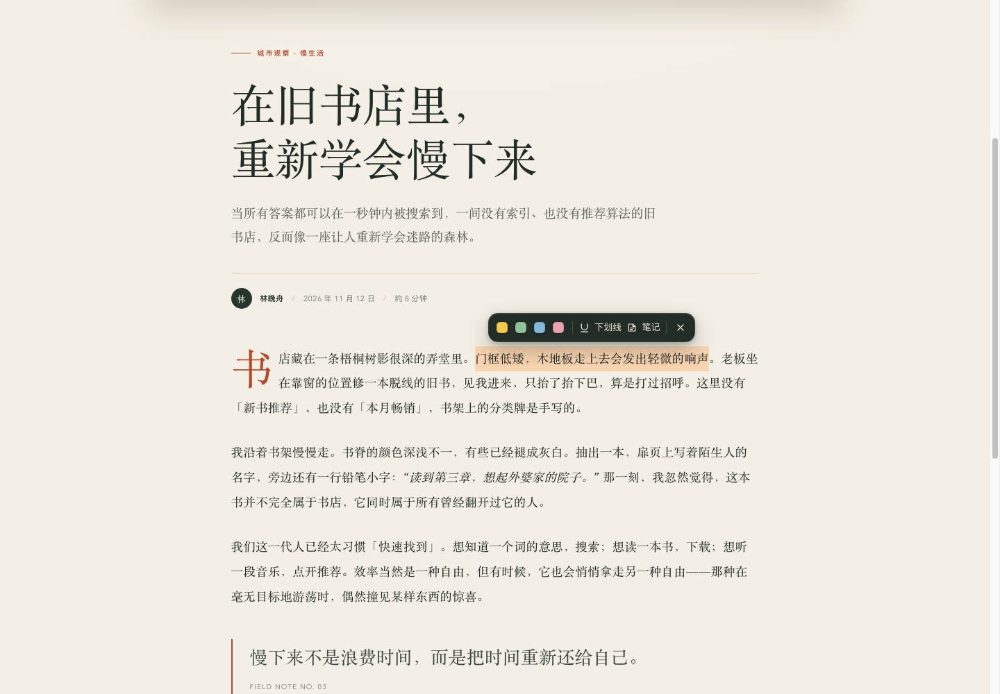
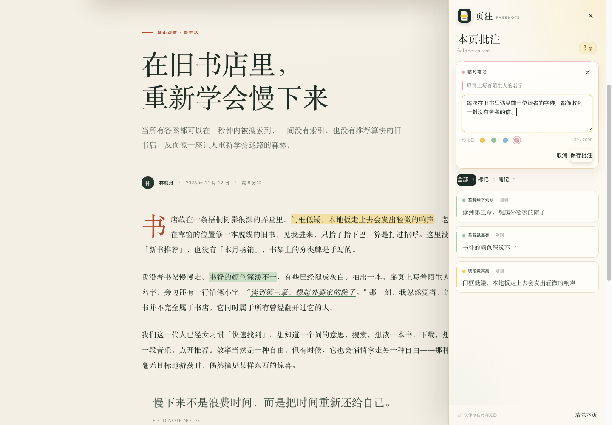
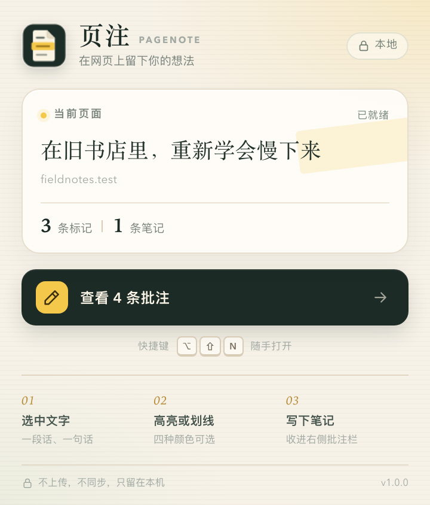

# 页注 · PageNote

[](https://github.com/yuanxiao2630/pagenote/releases/latest)
[](LICENSE)

> 在网页上留下你的想法。选中一句话，高亮、划线，或把一条小笔记放进右侧的批注栏。

一个面向 Chrome / Edge 的轻量网页批注扩展。所有批注只保存在本机，不上传、不注册、不打扰页面原本的结构。



## 功能

- **划词即用**：选中网页文字后浮出工具条，可直接添加琥珀黄、苔藓绿、雾霭蓝、山茶粉四种颜色的高亮，也可以画下划线。
- **右侧临时笔记**：点工具条上的「笔记」，选区会自动收进右侧批注栏，在那里写下想法。笔记会跟随原文保存，不当成网页的一部分改坏页面。
- **每页独立的批注栏**：右侧抽屉按页面整理全部标记与笔记，可按「全部 / 标记 / 笔记」筛选；点卡片即可定位原文。
- **随时管理**：编辑笔记、删除单条批注、清空本页；删除与清空都支持一次「撤销」。
- **本地持久化**：按页面地址保存在 `chrome.storage.local` 中，刷新页面、重启浏览器后仍在。同一浏览器里打开同一页面会看到同样的批注。
- **不破坏网页 DOM**：高亮和下划线通过 CSS Custom Highlight API 绘制，不包裹、不替换页面文本节点；界面全部装在 Shadow DOM 里，不受网页样式影响，也尽量不影响网页本身。
- **结构变了也能找回来**：每条批注同时记录 DOM 路径、原文引文和前后文。网页内容轻微调整后，会用引文重新定位；实在找不到时会保留笔记并标记「原文位置已变化」。
- **干净、克制**：只有选中文字时才出现工具条；有批注时右侧才会出现一枚窄窄的「批注」标签，点开才是批注栏。

<p align="center">
  
</p>

<p align="center">
  
</p>

<p align="center">
  
</p>

## 安装（开发者模式）

本项目不需要构建，也没有依赖。

1. 从 [GitHub Releases](https://github.com/yuanxiao2630/pagenote/releases/latest) 下载最新的 `pagenote-v1.0.0.zip` 并解压，或克隆源码目录。
2. 打开 Chrome 的 `chrome://extensions`（Edge 为 `edge://extensions`）。
3. 打开右上角的 **开发者模式**。
4. 点击 **加载已解压的扩展程序**，选择包含 `manifest.json` 的 `pagenote` 文件夹。
5. 建议点击扩展图标旁的图钉，把「页注」固定到工具栏。

> 如果要在本地 `file://` 页面上使用，需要在扩展详情页额外开启「允许访问文件网址」。

## 使用

1. 打开任意普通网页，用鼠标选中一段文字。
2. 在浮出的工具条上点一种颜色高亮，或点「下划线」。
3. 想记点什么时，点「笔记」。右侧会打开批注栏，并出现一条 **临时笔记**：选一个标记色，写下内容，按 **保存批注**。
4. 之后点击网页上带标记的文字、页面右侧的「批注」标签，或扩展图标里的「打开本页批注」，都可以重新打开批注栏。
5. 在批注栏里点卡片定位原文，点卡片右上角的按钮编辑笔记或删除批注；底部的「清除本页」可在两次点击后清空本页。

### 快捷键

| 功能 | macOS | Windows / Linux |
| --- | --- | --- |
| 打开 / 关闭本页批注栏 | `⌥ ⇧ N` | `Alt + Shift + N` |
| 用琥珀黄高亮所选文字 | `⌥ ⇧ H` | `Alt + Shift + H` |
| 为所选文字添加笔记 | `⌥ ⇧ M` | `Alt + Shift + M` |

工具条出现时，还可以直接用键盘：

| 按键 | 功能 |
| --- | --- |
| `1` `2` `3` `4` | 琥珀黄 / 苔藓绿 / 雾霭蓝 / 山茶粉高亮 |
| `U` | 添加下划线 |
| `N` | 添加临时笔记 |
| `Esc` | 收起工具条 |
| `⌘ / Ctrl + Enter` | 保存正在编辑的笔记 |
| `Esc` | 未保存的笔记会先要求确认放弃 |

快捷键可以在 `chrome://extensions/shortcuts` 中重新分配。

## 关于 PDF

目前**主要支持普通网页**。需要明确的是：

- **Chrome / Edge 内置的 PDF 阅读器暂不支持**。它是浏览器内部页面，扩展既不能注入工具条，也不能读取 PDF 文字。打开 `.pdf` 时，扩展弹窗会给出明确提示。
- 使用 **PDF.js 等网页版 PDF 阅读器**打开的 PDF，如果文字是可选择的文本层，就可以像普通网页一样划词、高亮和写笔记。
- 原生 PDF 文本层的批注支持是后续方向，目前没有在代码里假装支持。

## 权限说明

| 权限 | 用途 |
| --- | --- |
| `storage` | 按页面保存高亮、下划线、笔记和定位信息 |
| `activeTab` + `scripting` | 在安装扩展前已经打开的标签页中按需注入界面 |
| `contextMenus` | 右键菜单「打开页注批注栏」 |
| 网站访问权限 | 通过 content script 在网页中显示选词工具条与批注栏 |

**隐私**：扩展没有任何网络请求，不包含统计、远程配置或账号系统。批注内容只存在于当前浏览器配置的 `chrome.storage.local` 中，不会同步或上传。

## 实现说明

- **界面隔离**：`pagenote-root` 宿主使用 fixed 定位与最高层级，内部 Shadow DOM 承载工具条、批注栏和提示；样式通过 constructable stylesheet 注入，不需要页面内联样式，也更不容易被网页 CSS 污染。
- **文字标记**：`CSS.highlights` 注册 `::highlight()` 伪元素，按颜色与类型分组绘制。页面 DOM 不变，Text 节点不被切开，React / Vue 等页面更安全。
- **锚点恢复**：保存 `Range` 的起止 DOM 路径、偏移、原文引文和前后文；恢复时先走路径校验，再退回到文档文本中的引文匹配，尽量在页面小幅改版后仍能定位。
- **存储**：页面 key 为去掉 hash 的 `origin + pathname + search`。页面内路由切换会重新读取对应页面的批注。
- **限制**：单次选区最长 4000 字，单条笔记最长 2000 字。

## 目录结构

```
pagenote/
├── manifest.json
├── background.js          # 快捷键、右键菜单、按需注入
├── shared/
│   └── constants.js       # 颜色、页面 key、通用格式化
├── content/
│   ├── styles.js          # Shadow DOM 内的界面样式
│   └── content.js         # 选词、批注、锚点、批注栏
├── popup/
│   ├── popup.html
│   ├── popup.css
│   └── popup.js
├── icons/
├── docs/                  # README 截图
├── scripts/package.sh     # 生成可安装的 zip
├── test/                  # 本地验收用文章页，不参与打包
└── CHANGELOG.md
```

## 已知限制

- 不支持 `chrome://`、`edge://`、Chrome 应用商店等浏览器内部页面。
- 不支持 Chrome / Edge 内置 PDF 阅读器；PDF.js 等网页阅读器取决于文本层是否可选。
- 只处理顶层页面；iframe 内的文字、Canvas 绘制的文字和封闭 Shadow DOM 中的文字无法批注。
- 极端改版、内容被删除或替换时，批注可能失去原文位置；笔记本身不会丢，卡片会提示「原文位置已变化」。
- 数据不做云同步；换浏览器配置或重装扩展前需要自行导出（当前版本未提供导出 UI）。
- 仅针对 Chromium 内核浏览器开发，未适配 Firefox / Safari。

## 开发与验收

日常开发没有构建步骤。修改后到 `chrome://extensions` 点击扩展卡片上的刷新按钮，再刷新目标页面即可。

发布前可运行：

```bash
./scripts/package.sh
```

脚本会读取 `manifest.json` 的版本号，在 `dist/` 生成 `pagenote-vX.Y.Z.zip` 并输出 SHA-256。

已在 Chrome for Testing 151 上完成以下手动验收：

- 划词工具条定位、四种颜色高亮、下划线；
- 右侧临时笔记的新增、编辑、删除、撤销、清空与筛选；
- 刷新后批注恢复；
- 页面 DOM 插入新段落导致路径失效后，按引文重新定位；
- 点击网页高亮打开批注栏并定位到对应卡片；
- 390px 窄屏下工具条与批注栏布局；
- 弹窗对普通页面、不可用页面和 PDF 页面的状态展示。

`test/article.html` 是用于上述验收的本地文章页，可用任意静态服务器打开。

---

页注 · PageNote v1.0.0 · 本地优先的网页批注。
